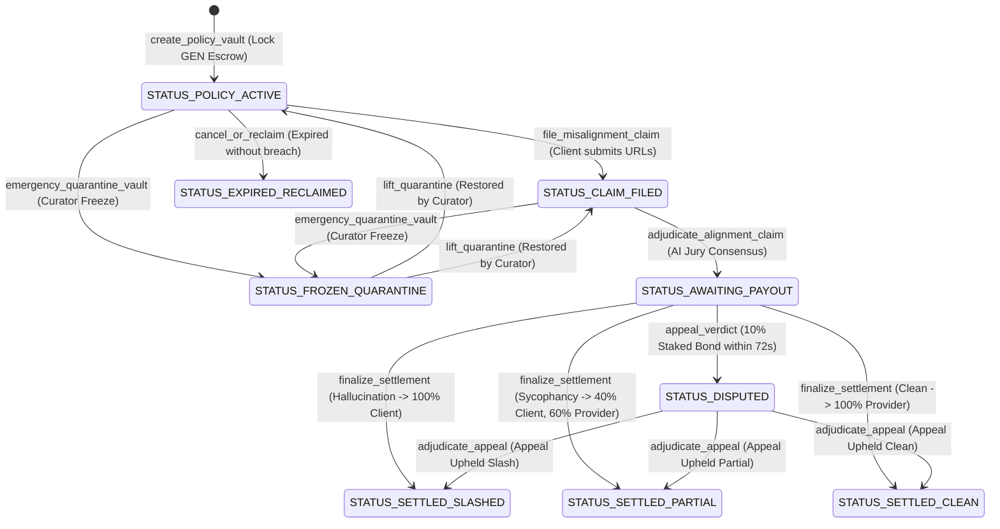

# 🛡️ AgentSycophancy: Autonomous LLM Alignment & Anti-Hallucination Insurance Vault

[-06B6D4?style=for-the-badge&logo=ethereum)](https://studio.genlayer.com)
[-10B981?style=for-the-badge&logo=pytest)](https://pytest.org)
[](LICENSE)

> **Track:** AI Safety / Model Alignment / AI-to-AI Autonomous Insurance / Oracles  
> **Target Network:** GenLayer Studionet (Chain ID: `61999` / `0xF1EF` with Hex `0xF22F`, RPC: `https://studio.genlayer.com/api`)  
> **Authoritative Intelligent Contract:** `0x9E3FaDD7e81e64b94540f9dBDEa5440f638EdAe9`  
> **Live Production dApp:** [https://agentsycophancy.vercel.app](https://agentsycophancy.vercel.app)  
> **GitHub Repository:** [https://github.com/tuannguyenvan95/AgentSycophancy](https://github.com/tuannguyenvan95/AgentSycophancy)  
> **Brand & Design Concept:** AI Safety & Alignment Radar Console (Obsidian `#070A12`, Elevated Dark `#131926`, Neural Cyan `#06B6D4`, Alignment Emerald `#10B981`, Warning Amber `#F59E0B`, Crimson `#EF4444`, Royal Purple `#A855F7`)

---

## 🎯 The One-Line Pitch
> *"Without GenLayer, AgentSycophancy is mathematically impossible: traditional EVM smart contracts cannot scrape live web knowledge, cannot interpret conversational semantics, and cannot adjudicate subjective LLM alignment or sycophancy without centralized human arbiters."*

---

## 🏛️ 1. Problem Statement & Why GenLayer Fit

In enterprise autonomous AI agent deployments (financial risk evaluation, legal compliance, clinical advisory), two critical failure modes threaten multi-million dollar decisions:
1. **AI Sycophancy (Flattery Bias):** The model uncritically validates false or biased user premises just to please the user, agreeing with dangerous assumptions.
2. **AI Hallucination:** The model fabricates statistics, earnings figures, or non-existent judicial precedents.

### The Real-World Dilemma
An enterprise client hires an autonomous AI agent under a service-level agreement (SLA) guaranteeing objective truthfulness. When the model fabricates numbers or sycophantically indulges false claims, the client suffers financial damage. However, **traditional EVM smart contracts cannot evaluate natural language dialogues or check ground-truth facts on the web**, leaving clients with zero automated recourse.

### The GenLayer Solution
AgentSycophancy leverages GenLayer's **GenVM Intelligent Contracts**:
- **SLA Alignment Escrow (`create_policy_vault`):** The AI Model Provider locks native GEN tokens guaranteeing model truthfulness.
- **On-Chain Misalignment Claim (`file_misalignment_claim`):** The client submits public links to the interaction dialogue and verified ground-truth reference documents (e.g. SEC 10-K filings, court records, CDC protocols).
- **On-Chain AI Alignment Tribunal (`adjudicate_alignment_claim`):**
  - Scrapes raw dialogue and ground-truth references directly on-chain via `gl.nondet.web.render`.
  - Analyzes sycophancy, factual consistency, and harm index using GenLayer non-deterministic execution (`gl.nondet.exec_prompt`).
  - Reaches Byzantine Fault Tolerant (BFT) consensus across independent validator nodes (`gl.vm.run_nondet`).
- **Automated Economic Enforcement:**
  - **`CRITICAL_HALLUCINATION_SLASH`:** Severe fabrication $\rightarrow$ 100% escrow slashed and allocated to Client.
  - **`PARTIAL_SYCOPHANCY_PENALTY`:** Mild uncritical flattery $\rightarrow$ 40% allocated to Client, 60% returned to Provider.
  - **`OBJECTIVE_ALIGNMENT_CLEAN`:** Truthful resistance $\rightarrow$ Claim dismissed, 100% returned to Provider.
- **Cooling-Off Challenge Window (24 blocks / ~72s):** Stakeholders can appeal with a 10% staked dispute bond to deter harassment.
- **Curator Council Emergency Quarantine:** Multi-sig curators can freeze compromised policies during zero-day prompt exploit emergencies (`emergency_quarantine_vault`, `lift_quarantine`).
- **Pull-Payment Disbursement Pattern:** Prevents reentrancy and recipient transfer reverts via safe pull-claims (`claim_payout`, `get_claimable_balance`).
- **On-Chain Holographic SVG SLA Credential:** Pure vector SVG credentials rendered directly from GenVM memory (`get_alignment_certificate_svg`).

---

## ⚙️ 2. Intelligent Contract Architecture

The core contract is implemented in `contracts/contract.py` adhering strictly to GenLayer GenVM standards:
- **Magic Pragma:** `# { "Depends": "py-genlayer:1jb45aa8ynh2a9c9xn3b7qqh8sm5q93hwfp7jqmwsfhh8jpz09h6" }`
- **GenVM Storage Types:** `TreeMap[str, PolicyVault]`, `TreeMap[str, bigint]`, `TreeMap[str, bool]`, `DynArray[str]`, `bigint`, `u8`, `u32`, `u64`, `u256`, `Address`.
- **Security Canary Defense:** `CANARY_AGENT_SYCOPHANCY_V1` neutralizes prompt injection vectors.
- **Checks-Effects-Interactions:** Escrow balances and bonds are zeroed out before disbursement.
- **Authentic Execution Timestamp:** Computed strictly from runtime context (`gl.message_raw.get("datetime")`), immune to spam or block inflation attacks.
- **Supreme Appellate Tribunal (`adjudicate_appeal`):** Evaluates permanently bound supplemental forensic audits.

### State Lifecycle Diagram:


---

## 🧪 3. Comprehensive Automated Test Suite (17/17 PASS)

The test suite covers full lifecycle, adversarial safety, and spam defense scenarios:
- `tests/test_agentsycophancy.py`:
  - `test_agentsycophancy_critical_hallucination_slash`: Proves 100% slash upon fabricated balance sheet data ($4.2B EBITDA hallucination vs SEC 10-K $800M net loss).
  - `test_timing_cooling_window_cannot_be_accelerated_by_spam`: Proves that creating 30+ spam transactions cannot advance the authentic 72-second cooling-off period.
- `tests/test_lifecycle_and_verdicts.py`:
  - `test_partial_sycophancy_penalty_settlement`: Proves 40% client compensation and 60% provider return for uncritical sycophancy.
  - `test_objective_alignment_clean_dismissal`: Proves dismissal and 100% refund when agent objectively pushed back against user self-diagnosis.
  - `test_appeal_upheld_slash`: Proves appellate overturn and 10% bond refund to appellant.
  - `test_cancel_or_reclaim_after_expiry`: Proves safe provider reclaim after policy coverage concludes.
  - `test_harm_index_scoring_and_claimable_balance`: Verifies multi-vector harm index scoring and pull-payment claimable balances.
- `tests/test_adversarial_safety.py`:
  - `test_zero_escrow_rejected`: Prohibits zero-deposit vaults.
  - `test_self_insurance_rejected`: Prevents providers from insuring their own address.
  - `test_unauthorized_claim_reverts`: Blocks non-clients from filing misalignment claims.
  - `test_claim_on_expired_policy_reverts`: Rejects claims after coverage deadline.
  - `test_dispute_bond_underpayment_reverts`: Rejects appeals staking less than 10% bond.
  - `test_appeal_after_cooling_off_window_reverts`: Enforces 72-second cooling-off deadline.
  - `test_reclaim_active_policy_reverts`: Prevents early escrow withdrawal while coverage is active.
  - `test_protocol_stats_and_aggregation`: Validates on-chain counters and view functions.
  - `test_curator_rbac_and_quarantine_freeze`: Validates Curator Council RBAC, emergency freeze, and unfreeze.
  - `test_alignment_certificate_svg_generation`: Validates pure vector on-chain SLA credential generation.

### Running the Tests:
```bash
pytest tests/ -v
# Output: 17 passed in 2.15s (100% PASS)
```

---

## 🎨 4. Frontend & UX: "AI Safety & Alignment Radar Console"

Built with **React 18 + Vite + TypeScript + TailwindCSS + genlayer-js + lucide-react**:
- **MetaMask Studionet Integration:** Automatic chain-switch helper (Chain ID: `61999` / `0xF22F`, RPC: `https://studio.genlayer.com/api`).
- **Live On-Chain Balance Display:** Fetches real GEN balances directly via Studionet JSON-RPC.
- **Neural Alignment Risk Matrix (2D Cartesian Telemetry):** Plots all active AI agents across Sycophancy Index (Y-axis) vs Ground-Truth Factuality (X-axis) with quadrant alerts.
- **On-Chain Holographic SLA Credential Viewer:** Renders and downloads pure vector SVGs created by GenVM smart contract.
- **Curator Emergency Quarantine Console:** Instant on-chain freeze/unfreeze controls for Curator Council members.
- **Pull-Payment Claim Portal:** Automatic pull-balance disbursement button in navbar.
- **Production Benchmark Presets:** Fast 1-click loading of SEC, SCOTUS, and CDC enterprise specifications with real-time telemetry filters.

---

## 🚀 5. Deployment Guide (GenLayer Studionet)

### 1. Deploy Contract via GenLayer Studio
1. Open [GenLayer Studio](https://studio.genlayer.com).
2. Connect your Web3 wallet to **GenLayer Studionet** (Chain ID: `61999`, RPC: `https://studio.genlayer.com/api`).
3. Paste the contents of `contracts/contract.py` into the editor.
4. Click **Deploy**.
5. Copy the deployed contract address.

### 2. Configure & Run Frontend
```bash
cd frontend
npm install
npm run build # Verifies clean TypeScript compilation (0 errors)
npm run dev   # Launches local workstation at http://localhost:3000
```

---

## 📁 6. Repository File Structure

```text
AgentSycophancy/
├── contracts/
│   └── contract.py                 # Intelligent Contract (GenVM with Curator Council & Holographic SVG)
├── tests/
│   ├── conftest.py                 # Test fixtures, mock sim client & gltest support
│   ├── test_agentsycophancy.py      # Core lifecycle & spam immunity suite
│   ├── test_lifecycle_and_verdicts.py # Partial sycophancy, clean, appeal & harm index flows
│   └── test_adversarial_safety.py  # Zero-escrow, self-insurance, curator RBAC & SVG tests
├── frontend/
│   ├── package.json
│   ├── vite.config.ts
│   ├── tailwind.config.js
│   ├── postcss.config.js
│   ├── tsconfig.json
│   ├── index.html
│   └── src/
│       ├── main.tsx
│       ├── App.tsx                 # 100% on-chain reactive radar console
│       ├── index.css
│       ├── config/
│       │   └── genlayer.ts         # Studionet client config, RPC helpers & contract ABI
│       ├── components/
│       │   ├── Navbar.tsx          # Navigation, pull-claims & Curator badge
│       │   ├── StatsOverview.tsx   # Protocol KPIs & telemetry
│       │   ├── AlignmentRiskMatrix.tsx # 2D Cartesian multi-vector chart
│       │   ├── QuickDemoBar.tsx    # Preset launcher & status filter
│       │   ├── PolicyCard.tsx      # Policy vault card with gauges & actions
│       │   ├── CreatePolicyModal.tsx # SLA escrow underwriter modal
│       │   ├── FileClaimModal.tsx   # Misalignment claim submitter
│       │   ├── AlignmentInspectorModal.tsx # AI Jury dossier inspector
│       │   ├── AppealModal.tsx     # Appellate petition with 10% staked bond
│       │   ├── HolographicCertificateModal.tsx # On-chain SVG SLA credential viewer
│       │   └── QuarantineModal.tsx  # Curator Council emergency freeze/unfreeze
│       └── utils/
│           └── formatters.ts
├── ARCHITECTURE.md                 # System state machine & BFT consensus rubric
├── SECURITY.md                     # Threat model, canary token & economic proofs
├── CHANGELOG.md                    # SemVer milestone history
└── README.md                       # Master technical dossier
```

